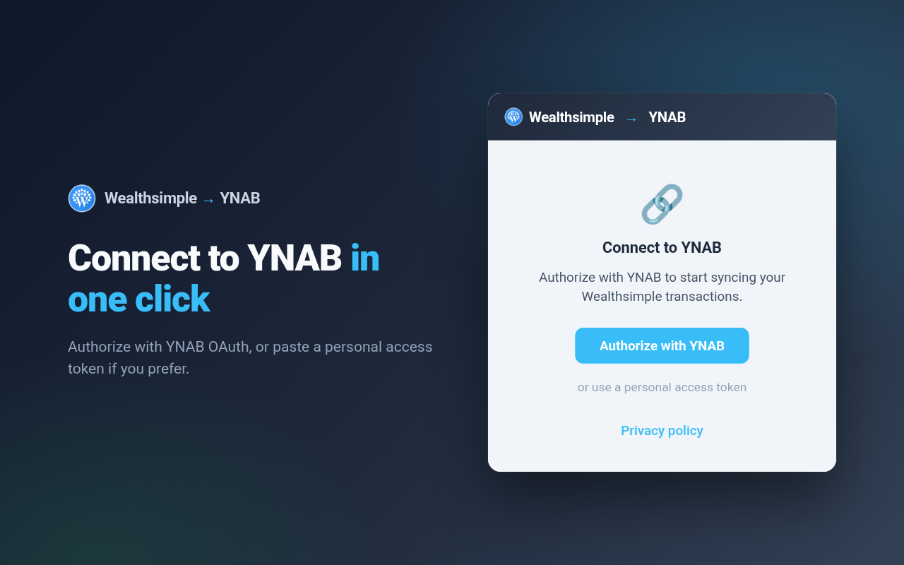
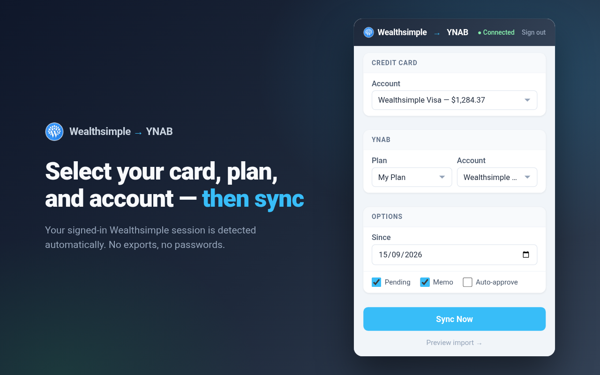
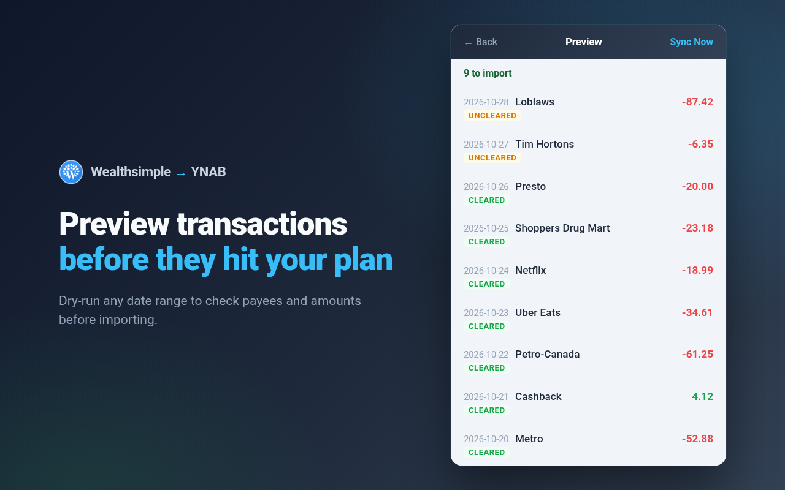
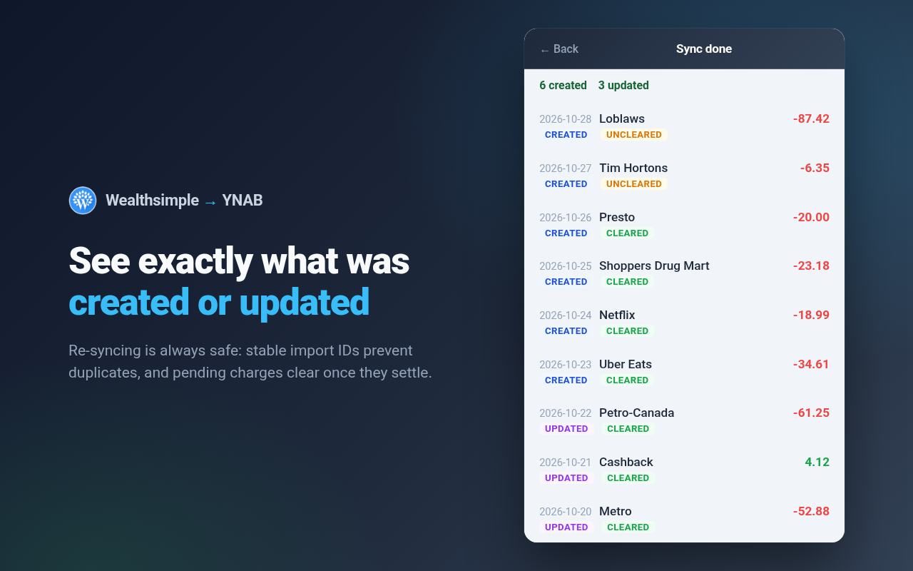

# Wealthsimple Credit Card Importer for YNAB

A browser extension that syncs Wealthsimple credit card transactions into [YNAB](https://www.ynab.com). It uses the Wealthsimple session you're already signed into, so you don't need to extract or paste a Wealthsimple token.

Everything runs locally in your browser: there's no backend server, and your data goes only to Wealthsimple and YNAB. See the [privacy policy](PRIVACY.md).

## Features

- **No Wealthsimple setup.** It detects your signed-in session through browser cookies.
- **Finds your credit cards automatically.** The popup lists your Wealthsimple credit cards with their balances.
- **Two ways to connect to YNAB:** one-click OAuth or a personal access token.
- **Dry-run mode.** Preview transactions before importing them.
- **No duplicates.** Stable import IDs make re-syncing the same date range safe.
- **Clearing status updates.** Pending transactions are marked cleared once they settle.
- **Works in Chrome and Firefox.** Both use Manifest V3.

## Screenshots

|                                                           |                                                                          |
| --------------------------------------------------------- | ------------------------------------------------------------------------ |
|  |  |
| **1. Connect** with YNAB OAuth or a personal access token | **2. Choose** your credit card, YNAB plan and account                    |
|  |                     |
| **3. Preview** transactions before they hit your plan     | **4. Sync** and see what was created or updated                          |

## Install

- **Chrome:** [Chrome Web Store](https://chromewebstore.google.com/detail/decfjofkfofbjanbcbdhhehddlmaemmm)
- **Firefox:** [Firefox Add-ons](https://addons.mozilla.org/firefox/addon/wealthsimple-cc-importer-ynab/)
- **Manual:** download the zip for your browser from the [latest release](https://github.com/Cretezy/wealthsimple-ynab/releases/latest), unzip it, and load it as an unpacked extension.

## Usage

1. Sign in to [Wealthsimple](https://my.wealthsimple.com) in your browser.
2. Open the extension popup and connect YNAB, either with **Authorize with YNAB** or with a [personal access token](https://app.ynab.com/settings/developer).
3. Pick your credit card, YNAB plan, and YNAB account.
4. Click **Sync Now**.

YNAB OAuth tokens expire after 2 hours. When that happens, the popup asks you to sign in again.

## Permissions

| Permission                      | Purpose                                                          |
| ------------------------------- | ---------------------------------------------------------------- |
| `cookies`                       | Reads the Wealthsimple session cookie to call Wealthsimple's API |
| `storage`                       | Saves your YNAB token and your selections (stored locally only)  |
| `identity`                      | Runs the YNAB OAuth sign-in flow                                 |
| `https://my.wealthsimple.com/*` | Fetches credit card accounts, balances, and activity             |
| `https://api.ynab.com/*`        | Creates and updates YNAB transactions                            |

## How it works

1. **Wealthsimple:** reads the `_oauth2_access_v2` cookie from `my.wealthsimple.com` and uses its access token to call Wealthsimple's GraphQL API for credit card accounts, balances, and activity.
2. **Mapping:** each activity becomes a YNAB transaction. The merchant becomes the payee, the amount is converted to milliunits, and a deterministic SHA-256 import ID is derived from the activity ID.
3. **YNAB:** transactions are submitted through the official [`ynab`](https://www.npmjs.com/package/ynab) SDK. YNAB rejects duplicate import IDs, and clearing status is updated on later syncs.

## Development

Requires Node and pnpm. The exact versions are pinned in [`mise.toml`](mise.toml).

```bash
pnpm install
pnpm dev            # Chrome, with hot reload
pnpm dev:firefox    # Firefox
```

Or load the unpacked build from `.output/chrome-mv3-dev/` (or `.output/firefox-mv3-dev/`).

```bash
pnpm compile      # Type-check
pnpm lint         # Lint
pnpm fmt:check    # Check formatting
```

### Building from source

These are also the build instructions for Firefox Add-ons source review.

```bash
pnpm install --frozen-lockfile
pnpm zip            # .output/wealthsimple-ynab-<version>-chrome.zip
pnpm zip:firefox    # .output/wealthsimple-ynab-<version>-firefox.zip (+ -sources.zip)
```

### Releasing

Releases are managed by [release-please](https://github.com/googleapis/release-please). Use [Conventional Commits](https://www.conventionalcommits.org) (`feat:`, `fix:`, …). Merging the release PR that release-please opens creates the tag and GitHub release, and CI attaches the Chrome zip, the Firefox zip, and the Firefox sources zip, ready to upload to the stores.

Store screenshots and promo images are in [`store-assets/`](store-assets/).

## Disclaimer

We are not affiliated, associated, or in any way officially connected with Wealthsimple Technologies Inc. or any of its subsidiaries or affiliates. The official Wealthsimple website can be found at <https://www.wealthsimple.com>. The name Wealthsimple, as well as related names, tradenames, marks, trademarks, emblems, and images, are trademarks of their respective owners.

This project uses Wealthsimple's private, undocumented API, which may change or break at any time. Use it at your own risk.

We are not affiliated, associated, or in any way officially connected with YNAB or any of its subsidiaries or affiliates. The official YNAB website can be found at <https://www.ynab.com>. The names YNAB and You Need A Budget, as well as related names, tradenames, marks, trademarks, emblems, and images are registered trademarks of YNAB.

## License

[GPL-3.0-only](LICENSE)
